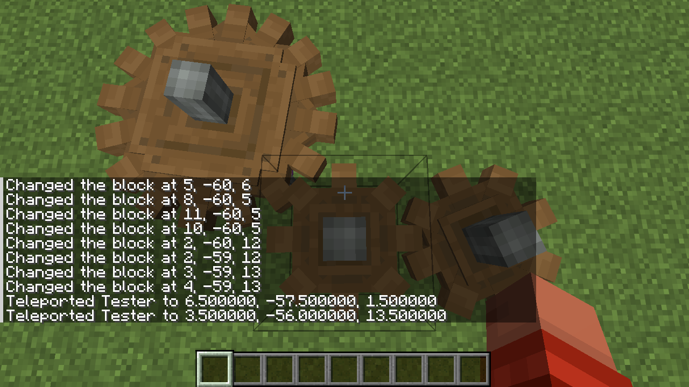
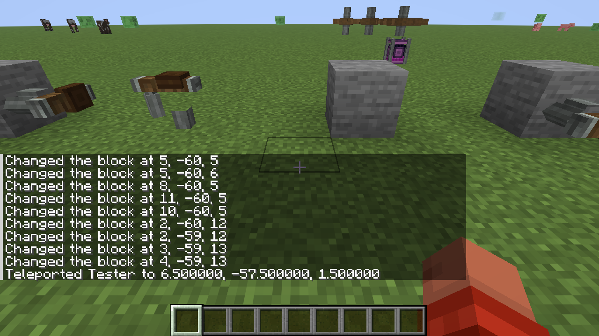

# Create (Polymer)

A server-side port of [Create](https://github.com/Creators-of-Create/Create) for **Fabric, Minecraft 26.3**, built on
[Polymer](https://github.com/Patbox/polymer). Only the server installs it. Players join with an unmodded
26.3 client and get Create's textures and models through a resource pack the server sends automatically.

This is an unofficial port and is not affiliated with or endorsed by the Create team.

## Status

Almost all of Create 6 is ported, with in-world game tests (about 900). Not ported: Ponder, advancements, the
config screen, recipe-viewer integration and ComputerCraft support.

| Area | What is in |
| --- | --- |
| Kinetics | Shafts, cogwheels, gearboxes, clutch, gearshift, sequenced gearshift, encased and chain drives, adjustable chain gearshift, rotation speed controller, hand crank, water wheels, windmill bearing, creative motor, flywheel, turntable, cuckoo clock, speedometer and stressometer, steam engine, whistles. Rotation propagation and the stress system are Create's code |
| Processing | Millstone, mechanical press, mixer, basin, blaze burner, crushing wheels, encased fan and nozzle, mechanical saw and drill, deployer, mechanical crafter, mechanical arm, sequenced assembly |
| Logistics | Belts and tunnels, chutes, funnels, depot, weighted ejector, item vault, item hatch, creative crate, list, attribute and package filters, chain conveyor |
| Packages | Packager, repackager, package frogport, postbox, stock link, stock ticker, redstone requester, factory gauge, table cloth |
| Fluids | Pipes, pumps, valves, smart pipes, hose pulley, fluid tanks and boilers, item drain, spout, portable fluid interface |
| Redstone | Analog lever, redstone link, contact, smart observer, threshold switch, pulse repeater, extender and timer, latches, desk bell, nixie tube (also shows train signals), rose quartz lamp, display link and display board with all of Create's sources, linked and lectern controller |
| Contraptions | Mechanical piston, bearings, chassis, gantry, rope and elevator pulleys, cart assembler, super glue, sticker, seats, drill, saw, harvester, plough, roller, deployer and portable interfaces on contraptions, contraption controls |
| Trains | Track (straight and curved, track paving), stations, bogeys, carriages, train controls, signals, track observers, schedules with an editor and auto-schedules, departure boards, train doors |
| Decoration | Stone palettes, glass and windows, metal and copper blocks, ladders and scaffolding, sliding doors and trapdoors, girders, brackets, placards, copycat panels and steps, bells, cardboard blocks |
| Equipment | Wrench, goggles, backtank and diving gear, potato cannon, extendo grip, toolbox, sand paper, super glue, clipboard, crafting blueprint, cardboard armour and sword, worldshaper, wand of symmetry |
| Schematics | Schematic and quill, schematic table, schematicannon, material checklists |
| Materials | Zinc ore and its worldgen, brass, andesite alloy, sheets, nuggets, rose quartz, food and other recipe ingredients |

Create's screens (filters, stations, schedules, clipboards, schematics and so on) are server-side chest-style menus.
Text is typed into an anvil text box.

## Limitations for vanilla clients

Players run an unmodded client, so everything that needs client code is replaced or left out.

- No connected textures: connected glass, framed glass, casings and similar blocks show their single-block texture.
- Stairs, walls and panes of the decoration palettes use the vanilla block shapes and models.
- Players standing on moving contraptions are held up with invisible shulker hitboxes and pushed along by the
  server; it works but is less smooth than with Create's client-side collision.
- Copycats show the copied block stretched to their shape, so textures on thin faces look squashed.
- Previews that Create draws on the client are shown with particles or outlines: the worldshaper's area, the
  schematic bounding box, and the symmetry mirror. A held schematic has no ghost-block preview.
- The linked controller reads the movement keys, so the player is held in place while it is in use.
- Models that Create loads as OBJ were converted to plain JSON models; Create's custom sounds are replaced by
  vanilla ones in a few places.
- No Ponder and no goggle overlay: goggle information is shown in the action bar.

## How it works

- Blocks are real server blocks. Players see an invisible stand-in (a barrier, or an invisible lightning rod for
  shafts) with the right hitbox. Create's own block models are shown on top with item display entities.
- Spinning parts are re-sent every few ticks and the client interpolates between updates. The angle follows
  Create's formula (`time × RPM × 0.3 + offset`), so neighbouring cogs mesh.
- Andesite casing uses one of Polymer's spare vanilla block states, so it renders as a normal full block.
- Moving parts (contraptions, trains, arms, doors) are display entities moved by the server with client-side
  interpolation.

## Screenshots (unmodded 26.3 client)




## Installing on a server

1. Fabric Loader ≥ 0.20.1 and Fabric API for 26.3.
2. Put `create-polymer-<version>.jar` in `mods/` (Polymer is bundled inside).
3. Start the server. On first start the mod turns on Polymer's resource-pack auto-hosting
   (`config/polymer/auto-host.json`) so players are offered the pack when they join.
   If your host blocks extra traffic on the game port, see Polymer's auto-host docs.

## Configuration

Server settings are in `config/create.json`, which is written with all defaults the first time the server starts.
The sections are named after Create's server config (`kinetics`, `logistics`, `fluids`, `equipment`, `trains`,
`schematics`, `recipes`) and the keys are Create's own, with Create's defaults, for example:

```json
{
  "kinetics": { "maxBeltLength": 20, "maxBlocksMoved": 2048, "movableObsidian": "UNMOVABLE" },
  "trains": { "maxBogeyCount": 20 },
  "stress": {
    "impact": { "millstone": 4.0 },
    "capacity": { "hand_crank": 8.0 }
  }
}
```

- Values outside Create's allowed range are clamped to it, and a value of the wrong type falls back to the default.
  Unknown keys are ignored. Each of these is reported as a warning in the server log.
- Keys missing from the file are added the next time it is loaded; your own values are kept.
- `stress` overrides the stress impact (`impact`) and the stress capacity (`capacity`) per Create block, using the block id
  without the `create:` prefix. The file lists every block that has a value.
- `/create config reload` (operator level 2) reads the file again. If the file cannot be parsed the current settings stay.
  Sizes that are fixed when a block is placed, such as `vaultCapacity` and `fluidTankCapacity`, only affect new blocks.
- Settings that only exist in Create's client config are not in the file. `fanParticleDensity` is a client option in Create and is a server
  setting here, because the server sends the particles.

## Building and testing

Requires JDK 25.

```bash
./gradlew build          # jar in build/libs
./gradlew runGametest    # in-world game tests
./gradlew runServer      # dev server in ./run
```

### Regenerating assets and data

Recipes, loot tables, tags, models, textures and language files are generated from a Create checkout:

```bash
tools/asset-scripts/run_all.sh path/to/Create
```

What gets copied is listed in `tools/asset-scripts/manifests/*.json` (items, blocks, models, blockstates, recipes,
tags, language keys). To port another block, add its ids to a manifest and run the script again; see
`tools/asset-scripts/README.md` for the manifest keys. The generated files are committed under `src/main/resources`.

## Licences

- Code is ported from Create, which is MIT-licensed (see `LICENSE.md`). New code in this repo is under the same licence.
- **Create's assets (textures, models, translations) are "All Rights Reserved" by the Create team.** This repo
  copies the subset needed for the ported blocks so the resource pack works. Distributing them publicly may need
  the Create team's permission.
